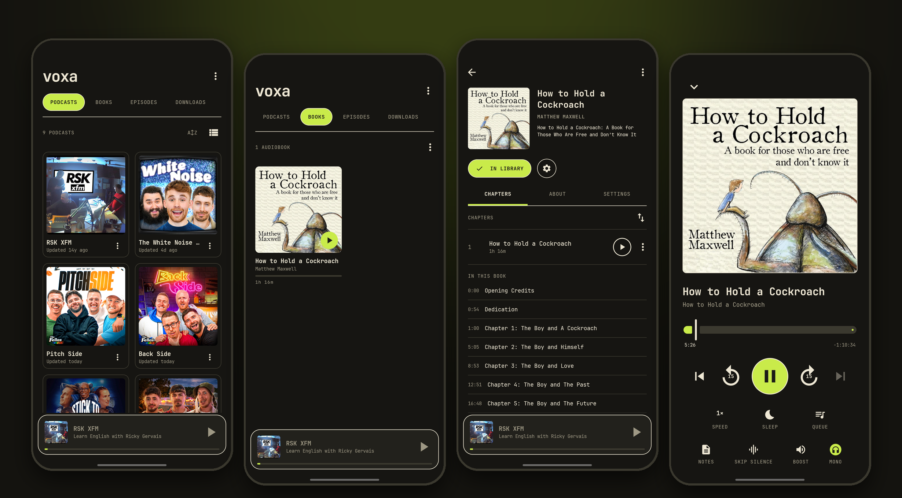
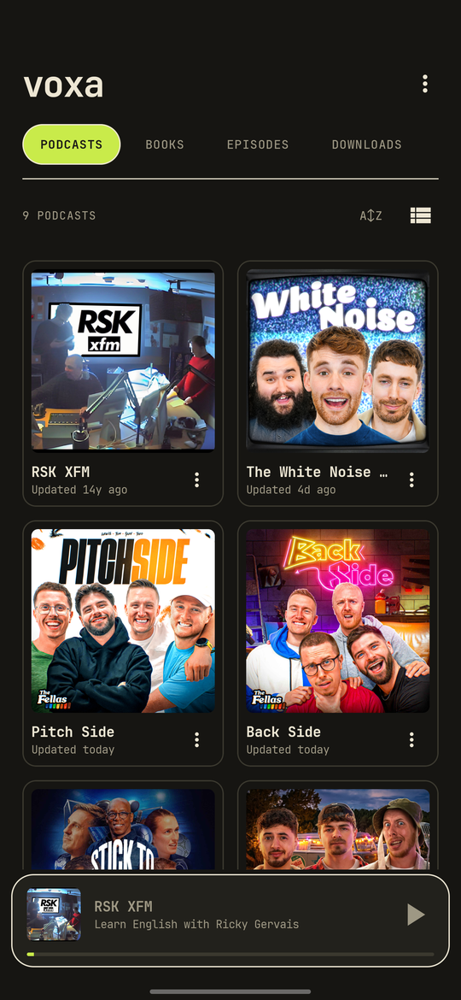
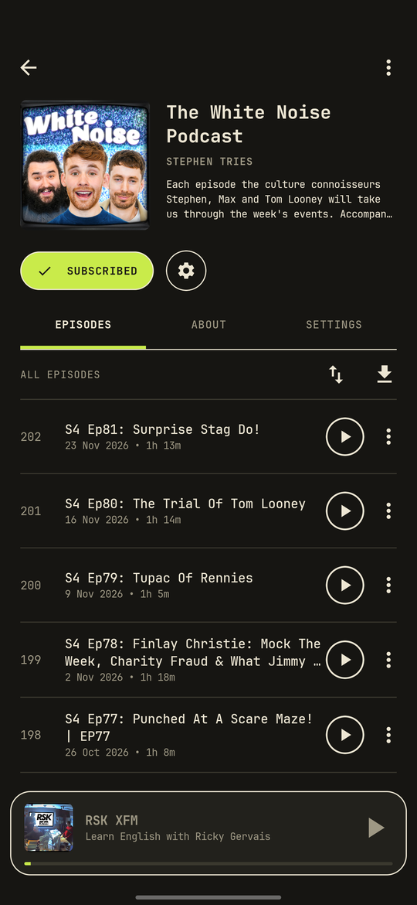
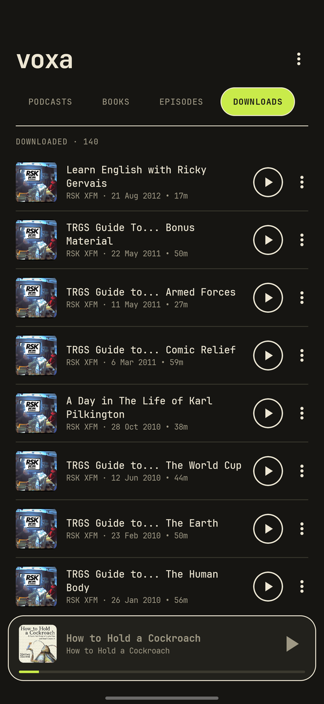
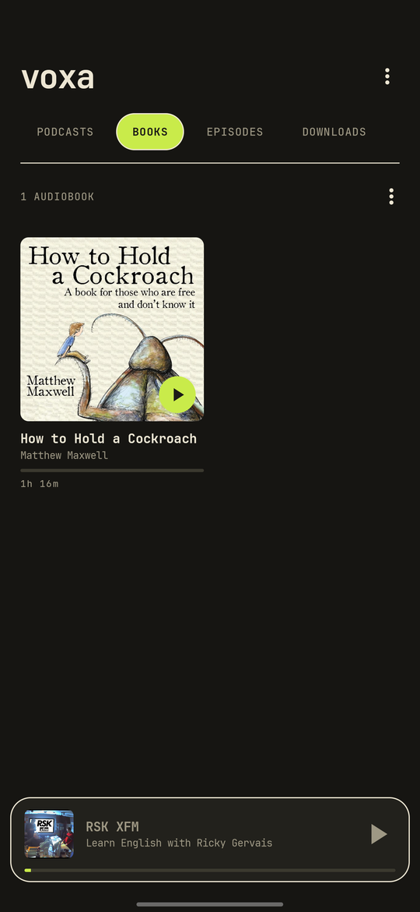
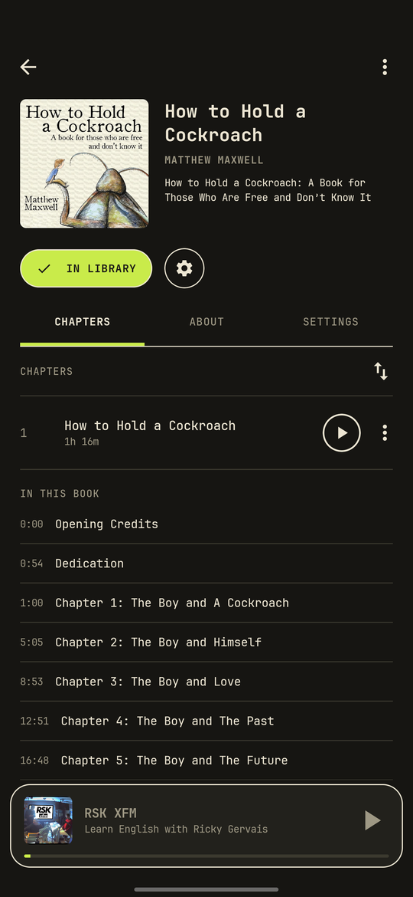
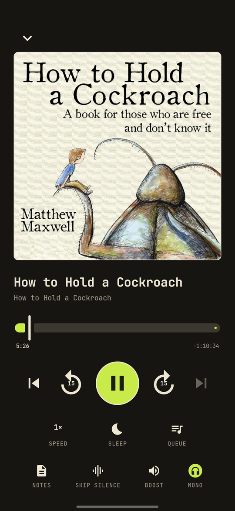

<div align="center">


# Voxa

**A deliberately simple podcast app, with a bookshelf for your audiobooks.**

Paste a feed URL. Your shows live in the order you choose. No search, no browse, no recommendations, no social.

[](#build-it)
[](https://kotlinlang.org)
[](https://developer.android.com/jetpack/compose)
[](https://developer.android.com/media/media3)
[](#features)

<br />



</div>

<br />

## Features

**Podcasts**
- **RSS only.** Paste a feed URL, or import an OPML file. Your shows sit in an order you control: grid or list, A–Z or custom, with arrow buttons to rearrange.
- **A show page that gets out of the way.** Numbered episodes, oldest or newest first (remembered per show), and a one-tap *download latest 5*.
- **Smart queue.** Playing an episode queues the rest of that show after it, in the show's own order, skipping anything hidden or already played.
- **Hide, don't delete.** Hide an episode and it vanishes from the list and from downloads, but nothing is removed and a refresh won't bring it back.
- **Background refresh** around 8am and 8pm, with a notification per show that has something new.
- **Backup and restore.** JSON (subscriptions, order, progress, played and hidden state, settings) and OPML.

**Audiobooks**
- **A Books tab.** Point Voxa at `Documents/Audiobooks` and your books appear as a cover grid with progress and time left. Tap a book to play it, tap again to pause, hold for its chapters.
- **A folder is a book.** A folder of audio files becomes one book with a chapter per file, in natural order (so `2` comes before `10`). A single `.m4b` is a book on its own.
- **Real chapters.** Embedded chapter lists are read from the file itself, in both formats audiobooks use: the common `chpl` atom and the QuickTime chapter track that Audible and Apple Books conversions use. Tap a chapter to jump there.
- **Tidy titles.** Long tag titles are shortened on the shelf (*How to Hold a Cockroach*, not the whole subtitle) and the full title stays on the book's page.
- **Your files are safe.** Voxa only reads them. Removing a book takes it out of the library and never deletes a file.

**Player**
- Seek, ±15 s skip, speed, sleep timer, queue, and a notes sheet with Podcasting 2.0 chapters and show notes.
- **Skip silence**, **volume boost** and a **mono mix** toggle.
- **Android Auto**: Voxa is a media library (Podcasts → shows → episodes), and playing from the car resumes and queues the rest.

**Look**
- Cream paper, ink and a lime accent, set in JetBrains Mono. Follows the system dark mode.

## Screenshots

<table>
  <tr>
    <td align="center"><br /><sub>Podcasts</sub></td>
    <td align="center"><br /><sub>A show</sub></td>
    <td align="center"><br /><sub>Downloads</sub></td>
  </tr>
  <tr>
    <td align="center"><br /><sub>Audiobooks</sub></td>
    <td align="center"><br /><sub>Chapters from the file</sub></td>
    <td align="center"><br /><sub>The player</sub></td>
  </tr>
</table>

## How it works

| Layer | What it does |
| --- | --- |
| **Room** | One database: shows and their episodes. An audiobook is a show of kind `audiobook` and its files are the episodes, so playback, resume and the queue work for books with no extra code. The podcast queries only ever return podcasts, so refresh, backup, OPML and Android Auto never see a book. |
| **Media3** | `PlaybackService` runs ExoPlayer inside a media session: background play, lock-screen controls, Android Auto, skip silence and a custom mono-mix audio processor. |
| **AudiobookScanner** | Walks the audiobooks folder, reads tags and covers, shortens titles, and only re-reads a book when its files change. |
| **Mp4Chapters** | Reads chapter lists straight out of `.m4b` files by walking the atom tree, so a 70 MB book is instant. |
| **WorkManager** | Twice-daily feed refresh and bulk downloads, with progress and a cancel button. |

```
app/src/main/java/dev/osianj/voxa/
├── data/       Room entities and DAOs, RSS parser, repository, downloads, backup,
│               audiobook scanner, title shortener, m4b chapter reader
├── playback/   PlaybackService (ExoPlayer + media session), connection, mono mix
└── ui/         Home, Books, Show, Player, Episode sheet, theme
```

## Build it

You need the Android SDK (platform 35) and a JDK 17–21. Android Studio works too: open the folder and sync.

```sh
git clone git@github.com:0sian/Voxa.git
cd Voxa
echo "sdk.dir=$HOME/Android/Sdk" > local.properties   # your SDK path
./gradlew assembleDebug
adb install -r app/build/outputs/apk/debug/app-debug.apk
```

Minimum Android 10 (API 29). Versions are pinned in `gradle/libs.versions.toml`. The debug APK is about 68 MB because the full Material icon set is bundled; a minified release build is much smaller.

**Audiobooks:** put each book in its own folder inside `Documents/Audiobooks` (one file per chapter), or drop a single `.m4b` in there. A `cover.jpg` in the folder is used as the cover, otherwise the picture inside the audio file. Voxa asks for *All files access* once, because Android's folder picker won't hand out folders like `Documents`. It is only used to read.

**Podcast downloads** go to private app storage by default, or a folder you pick (each show gets its own subfolder). Files already in a picked folder keep playing after a reinstall: with All files access, Voxa reads them directly instead of relying on a folder permission Android discards when an app is uninstalled.

## Roadmap

- [ ] Drag to reorder (edit order uses arrows for now)
- [ ] Exact-time refresh (Android picks the minute for the 8am/8pm checks)
- [ ] Keep the queue when the player service stops
- [ ] MP3 chapter tags (ID3 `CHAP`), so MP3 audiobooks can show chapters too
- [ ] Series and collections for audiobooks
- [ ] Monochrome launcher icon

## Credits

Set in [JetBrains Mono](https://www.jetbrains.com/lp/mono/) (SIL Open Font License, see `licenses/`). Built on [Media3](https://developer.android.com/media/media3), [Room](https://developer.android.com/training/data-storage/room) and [Coil](https://coil-kt.github.io/coil/).
